# Immich Mount

**Your [Immich](https://immich.app) photos and videos as a drive in Files (Nautilus), Dolphin and Finder.**

For **Linux**, on GNOME and KDE Plasma, and **macOS** 14 or later, on Apple silicon and Intel.

Immich Mount puts a self-hosted Immich library in your file manager and in every file open and upload dialog, as a
drive called **Immich Mount** (on Linux also Immich Drive or Immich, as you choose in Settings), much like a network
drive. Attach your holiday photos to an email, open a video in your editor, or drag new pictures in to upload them,
without downloading the library first.

> Immich Mount is an independent, unofficial project. It is not affiliated with, endorsed by, or sponsored by the
> Immich project or FUTO. "Immich" is used only to describe the server this software works with, and remains the
> mark of its owner.

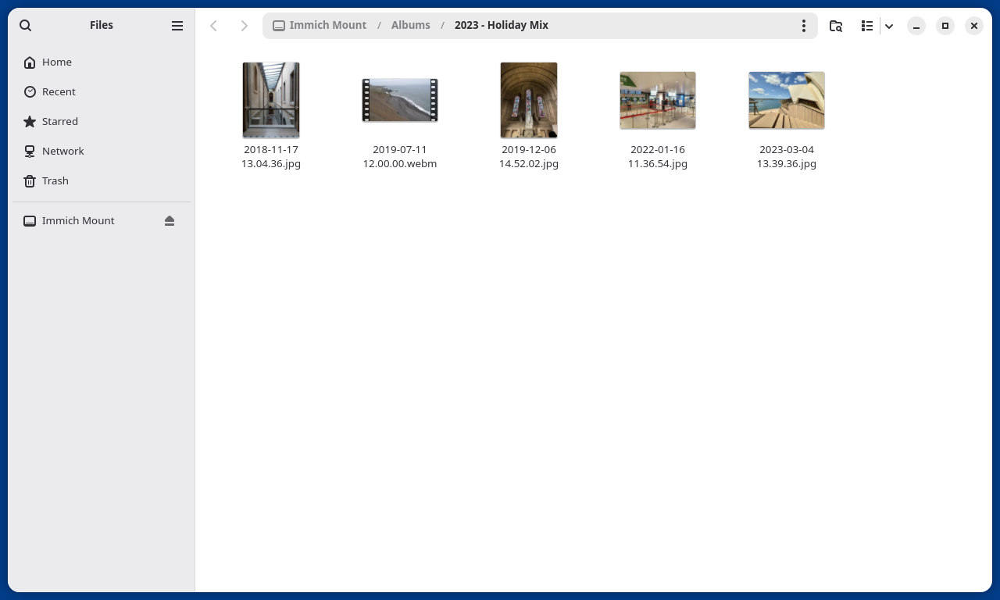

## What it does

- **Your library as folders:** the timeline by year and month, albums, people and places, and your archive if you
  switch it on, named the way Immich names them.
- **Thumbnails from the server,** so browsing a folder never downloads the photos in it.
- **Originals on demand:** a file is fetched only when a program opens it, and only the parts it reads. A video
  seeks without downloading the whole file. Folders you have visited stay browsable offline.
- **Uploads by copy and move:** drop photos and videos into **Upload** and they are uploaded unchanged, then show
  in Photos by their own date. Every other folder is a read-only view of the library. A move
  never loses a photo: Files keeps the source until Immich has the file, and anything that fails to upload is kept
  in a folder of its own.
- **Changes in Immich show within seconds,** in an open folder after a refresh.
- **One app, native on each desktop:** it opens in GTK and libadwaita on GNOME and in Kirigami on KDE Plasma, to sign
  in, choose what to show, and see the status. On the Mac it is a menu bar app, with the library in Finder's sidebar
  through Apple's File Provider, as iCloud Drive's is. Sign in with your server's single sign-on in your own browser (passkeys
  and password managers work as usual), with email and password, or with an API key. The credential stays in your
  keyring (GNOME Keyring or KWallet).
- **In your language:** the apps speak English and 20 more of the world's most spoken languages, Danish among
  them.
- **A command line and a background service** (`immich-mount`, a FUSE filesystem written in Rust), which also run
  headless, without a desktop.

```text
~/Immich/
├─ Photos/2024/03 March/2024-03-15 14.32.07.jpg
├─ Albums/2023 - Summer trip/
├─ People/<Name>/
└─ Places/<Country>/<City>/
```

<table><tr>
<td>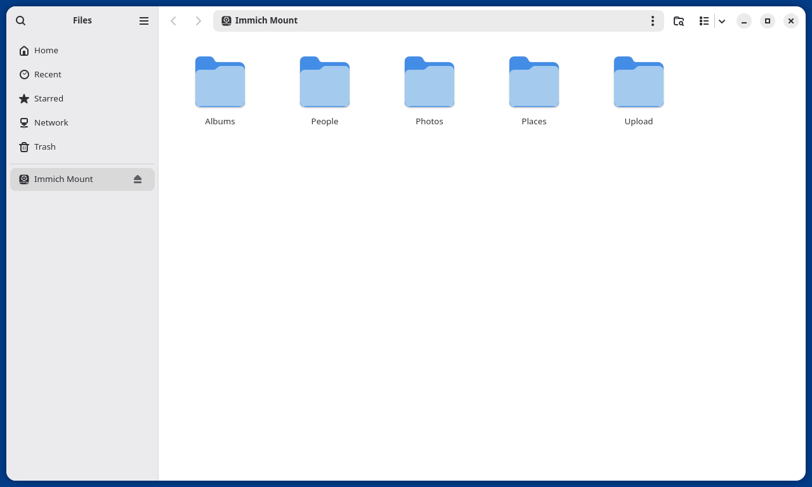</td>
<td>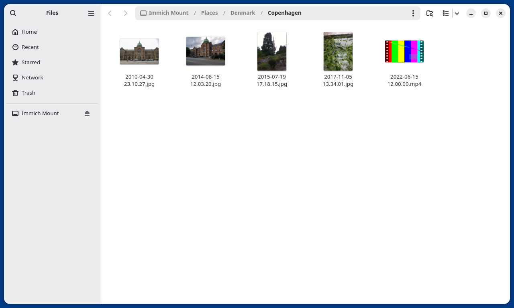</td>
</tr></table>

**What it does not do:** sync or mirror your library (libraries of hundreds of gigabytes stay on the server), edit,
rename or delete what is already in Immich, or replace Immich's own apps. Browsing photo by photo, search, faces,
sharing and editing stay in Immich's web and mobile apps.

## Install

### Linux

One app, which opens in the interface native to your desktop: Kirigami on KDE Plasma, GTK and libadwaita everywhere
else. With Homebrew (any Linux that has it, Bazzite included, with nothing layered onto the system), one command
installs all of it, and **Immich Mount** is then in the app grid:

```sh
brew install jakobhviid/tap/immich-mount
```

Or from the [latest release](https://github.com/jakobhviid/immich-mount/releases/latest):

| System | Packages |
|---|---|
| Fedora 44 | `immich-mount-*.x86_64.rpm`, plus `immich-mount-gnome-*.rpm` (GNOME) or `immich-mount-kde-*.rpm` (KDE Plasma) |
| Ubuntu 26.04, Kubuntu 26.04 | `immich-mount_*.deb`, plus `immich-mount-gnome_*.deb` or `immich-mount-kde_*.deb` |
| Fedora 43, Ubuntu 24.04, Debian 13 | `immich-mount` (.rpm or .deb): the mount and the command line, without the app |
| A server, with Homebrew | `brew install jakobhviid/tap/immich-mount-headless`: the mount and the command line |
| Any other Linux | `immich-mount-*-linux-musl.tar.gz`, a static binary with its user service |

```sh
sudo dnf install ./immich-mount*.rpm      # Fedora
sudo apt install ./immich-mount*.deb      # Ubuntu, Debian
```

You need an Immich server at v3.2 or later (the current and previous minor release are supported), FUSE 3
(`fuse3`, which the packages pull in), and a keyring for the desktop. Other ways to install, and building the
apps from source: [WORKFLOWS.md](WORKFLOWS.md#1-install).

### macOS

For macOS 14 or later, on Apple silicon and Intel, signed and notarized by Apple. With Homebrew:

```sh
brew install --cask jakobhviid/tap/immich-mount
```

Or download `immich-mount-<version>.dmg` from the [download page](https://jakob.hviid.phd/immich-mount/) or the
[releases](https://github.com/jakobhviid/immich-mount/releases), open it, drag **Immich Mount** into Applications,
and open it from there. Sign in,
then switch Immich Mount on in System Settings, under General, Login Items & Extensions, File Providers, once: the
app shows the way. It lives in the menu bar, and your library in Finder's sidebar. It updates itself.

## Getting started

**On the desktop,** open **Immich Mount** from the app grid, enter your server's address and sign in. Choose the
sections you want, and the library opens in Files or Dolphin. The app starts the mount itself, and it mounts again
at every login.

<table><tr>
<td>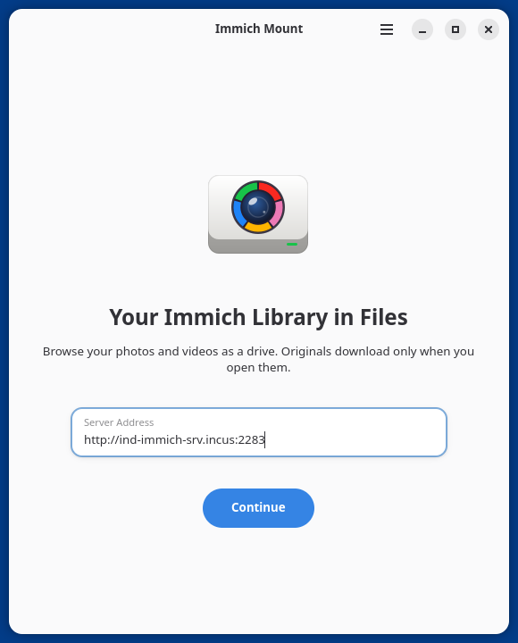</td>
<td>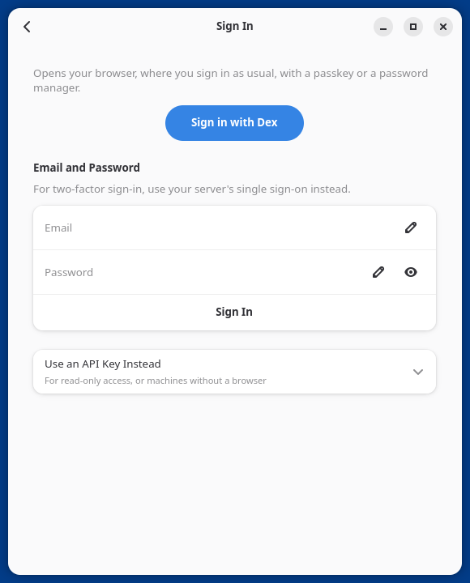</td>
<td>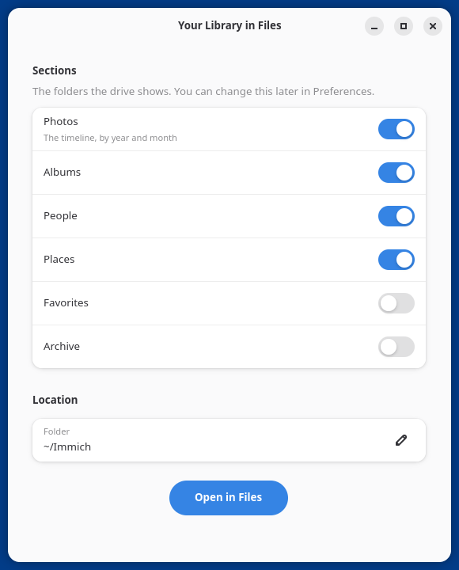</td>
<td>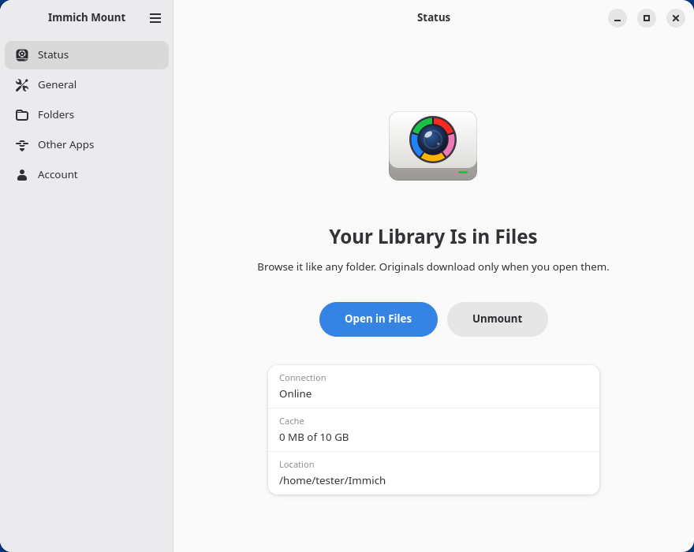</td>
</tr></table>

On KDE Plasma, the same app opens in Kirigami, puts the mount in Dolphin's Places, and offers to let Dolphin show
the thumbnails:

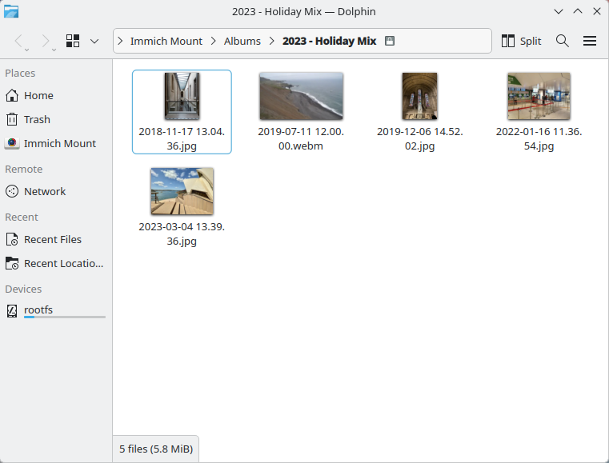

<table><tr>
<td>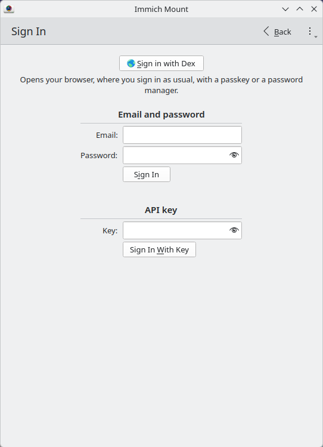</td>
<td>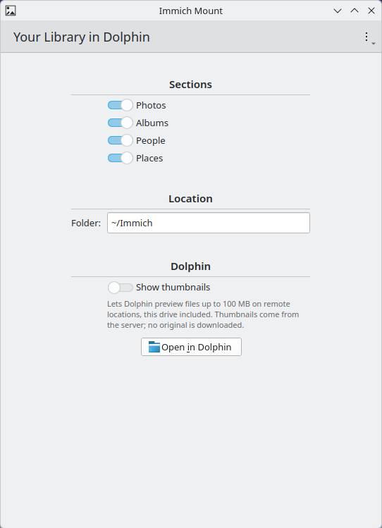</td>
<td>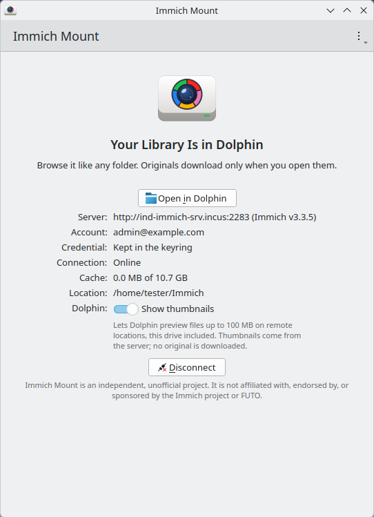</td>
</tr></table>

**From a terminal,** or on a machine without a desktop:

```sh
immich-mount login --server https://photos.example.org   # single sign-on: open the printed address in a browser
immich-mount mount                                       # mount now, and at every login
immich-mount status                                      # or: immich-mount doctor, when something is wrong
```

`--password` signs in with email and password instead, and `--api-key` with an API key. Everything else, from
settings to troubleshooting and uninstalling: [WORKFLOWS.md](WORKFLOWS.md).

## Status

New. Both desktops are tested from a fresh install in Fedora 44 VMs (GNOME 50 and Plasma 6.8) against a real
Immich server, and the packages install and remove cleanly on Fedora 43 and 44, Ubuntu 24.04 and 26.04, and
Debian 13. Releases follow semantic versioning: a change that breaks settings or behaviour bumps the major
version.

The macOS edition is new: signed and notarized, and tested on macOS 27 against a real Immich server. Not there
yet: packages in COPR and the AUR, and a Flatpak.
[ROADMAP.md](ROADMAP.md) has the plans and the open questions.

## Documentation

| File | What |
|---|---|
| [WORKFLOWS.md](WORKFLOWS.md) | What you run: install, sign in, status, doctor, settings, uploading, troubleshooting |
| [SPEC.md](SPEC.md) | Exactly what it does: the mount's layout, names, content, thumbnails, uploads, sign-in, settings, CLI, D-Bus |
| [ARCHITECTURE.md](ARCHITECTURE.md) | How it is built, and why: every design decision with its reasons |
| [PRINCIPLES.md](PRINCIPLES.md) | The invariants, and what earned them |
| [ROADMAP.md](ROADMAP.md) | Milestones, open questions, ideas parked on purpose |
| [AGENTS.md](AGENTS.md) | How to contribute: rules, the build, the checks before a push, and the test lab |
| [CREDITS.md](CREDITS.md) | Who this builds on |
| [SECURITY.md](SECURITY.md) | How to report a vulnerability, and what Immich Mount keeps on your machine |

`immich-mount --llm` prints all of this, plus the command reference, from the binary itself.

## Contributing

Bug reports and pull requests are welcome. Start with [AGENTS.md](AGENTS.md): it holds the rules (for people and AI
agents alike), how to build in a Fedora toolbox, and the checks that must pass before a push. Behaviour changes
ship with their doc change. Tests on real desktops run in disposable VMs on an Incus host (`lab/`), with the
procedures in `.claude/skills/`.

## Credits

- Inspired by **[Kartax/immich-desktop-app](https://github.com/Kartax/immich-desktop-app)**, which shows an Immich
  library as a drive in Finder on macOS. Thank you, Kartax.
- The Immich API layer started from **[immich-rs](https://github.com/boul2gom/immich-rs)** (MIT).
- **[Immich](https://github.com/immich-app/immich)**, the server all of this talks to.
- The photographers on **Wikimedia Commons** whose freely licensed photos fill the test server and the screenshots
  ([credited one by one](lab/immich-server/fixtures/ATTRIBUTION.md)).

More, including similar projects: [CREDITS.md](CREDITS.md).

## AI disclosure

Parts of this project were written with the assistance of AI coding agents (Claude Code, opencode, and others).
All changes are reviewed by the maintainer. The translations into 20 languages were made by an AI model: if you
speak one of them, corrections to its `po/<language>.po` are very welcome. This is the single place that fact is disclosed; it is deliberately
kept out of the commit history.

## License

[MIT](LICENSE). Code adapted from other MIT projects keeps its notice in
[THIRD-PARTY-NOTICES.md](THIRD-PARTY-NOTICES.md).
